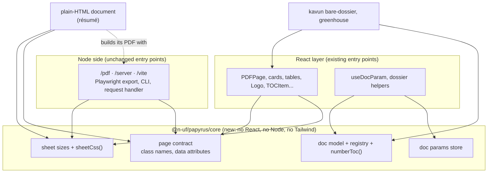

# Papyrus core split: proposal

> Pull the React-free logic and the page contract out into `@n-uf/papyrus/core`; keep the React
> components as a thin layer on top. No rewrite of the view components.

Status: stage 1 released (papyrus 0.4.0 + papyrus-react 0.4.0, 2026-11-03); stage 2 released
(papyrus 0.4.1, 2026-11-04); stage 3 done (dmetelin/resume builds with papyrus, pixel-identical PDF,
2026-11-04); stage 4 not started. Since 26.11.0 both packages use calendar versions
(`versioning-policy.md`).

Written while papyrus lived in `n-uf/angiospermae` (kavun and greenhouse were its neighbours there);
since 2026-11-09 it is its own repo, `n-uf/papyrus`, and published to npmjs too, so the "package
access for the résumé" notes below are history.

**Decision (2026-11-02): two packages instead of a `/core` subpath.** `@n-uf/papyrus` is now the
framework-free engine (what this proposal calls core, plus `/pdf`, `/server`, `/vite`); the React layer
is a new package, `@n-uf/papyrus-react`, with the old subpaths (same pattern as `@n-uf/doodl` +
`@n-uf/doodl-react`). Read "`@n-uf/papyrus/core`" below as "`@n-uf/papyrus`" and "the React layer" as
"`@n-uf/papyrus-react`". The core code still lives in `packages/papyrus/src/core/`. Done before any
release, so `/core` never shipped; consumers go through one breaking change (component imports move to
`@n-uf/papyrus-react`).

## Why

Papyrus's real value is the **page contract**: fixed sheets, the print CSS that keeps them one sheet per
PDF page, the page-count check, and the Playwright exporter. Today that contract is spread across the
React package and hard-codes A4 in four places, so a document that is not a React app, or not A4, cannot
use it. The first such document already exists: the résumé (plain
HTML, US-Letter sheets, printed by headless Chrome from `build.sh`).

## What is React-free today, and what is not

| Area | Files | React? | Notes |
| --- | --- | --- | --- |
| PDF exporter, CLI, fingerprints | `src/pdf/*.js` | no (Node) | hard-codes A4: `A4_VIEWPORT`, `PDF_PRINT_CSS`, `page.pdf({ format: "A4" })`; hard-codes the `.pdf-page` selector |
| PDF request handler | `src/server/index.js` | no (Node) | |
| Vite plugin | `src/vite/index.js` | no (Node) | |
| Print CSS | `src/styles/print-styles.ts` | no | A4 hard-coded (`210mm`/`297mm`); overlaps `PDF_PRINT_CSS` |
| Doc registry | `src/dossier/doc-registry.ts` | type only | `RegisteredDoc.component: React.ComponentType`; `getDocComponent` returns one |
| Doc model types | `src/dossier/doc-dossier-types.ts` | type only | `DocMeta`, `DocTocEntry` are plain data |
| Doc params | `src/params/use-doc-param.ts` | partly | `readDocParam`/`writeDocParam` are plain; the URL store is inside the hook |
| TOC section colours | `src/cards/toc-item.tsx` | partly | `getTocSectionColor` and the colour table are plain, in a TSX file |
| TOC numbering | **kavun** `bare-dossier.tsx` `generateTocNumbering` | no | belongs to the doc model, lives in the wrong package |
| Page/content blocks | `layout/`, `cards/`, `tables/`, `lists/`, `logo/`, `typography/`, `containers/`, `indicator/`, `file-list/` | yes | markup + Tailwind classes + inline colours; **stay React** |

There is no design-tokens module today: colours are inline `style` values in the TSX blocks. Turning them
into CSS variables is a later, optional step (see "Not now").

## Target layering



Rule: `src/core/**` imports nothing outside `src/core/`, no `react`, no `node:*`. An ESLint
`no-restricted-imports` block enforces it, the way kavun enforces its layer direction.

## What moves into `@n-uf/papyrus/core`

Written as **plain ESM `.js` + `.d.ts`**, like `src/pdf/`, not TypeScript source. Reason: a plain-HTML
document has no bundler and cannot import `.ts`. It also needs a ready-made stylesheet, so core ships
generated CSS files too.

### 1. Sheet sizes

```ts
interface SheetSize { name: string; width: string; height: string; viewport: { width: number; height: number } }
const SHEETS: { A4: SheetSize; LETTER: SheetSize };   // A4 210mm×297mm / 794×1123; LETTER 8.5in×11in / 816×1056
function sheetCss(sheet?: SheetSize, options?: { pageClass?: string }): string;  // @page + print/screen sheet rules
```

Static files generated from `sheetCss` at build/test time: `core/sheet-a4.css`, `core/sheet-letter.css`.

### 2. Page contract

The names the DOM and the exporter agree on, as constants, so neither side hard-codes them:

```ts
const PAGE_CLASS = "pdf-page";                     // one element = one PDF page
const CONTAINER_CLASS = "pdf-container";
const MAIN_CONTENT_CLASS = "pdf-main-content";
const NO_PRINT_CLASS = "no-print";
const AVOID_BREAK_CLASS = "avoid-break";
const PAGE_COUNT_ATTR = "data-papyrus-page-count";
```

The shadow/backdrop/rounded print fixes stay in the React layer (`blockPrintStyles` in `/styles`): they
target papyrus' own block classes and Tailwind utilities, not the page contract.

### 3. Doc model and registry

```ts
// types moved as-is: DocTocEntry, DocCategory, DocMeta
interface RegisteredDoc<C = unknown> { id: string; meta: DocMeta; component: C; figures?: DocFigures }
interface DocRegistry<C = unknown> { get; getIds; has; register }
function createDocRegistry<C = unknown>(): DocRegistry<C>;
const docRegistry: DocRegistry;                    // same Symbol.for global key as today
function numberToc(toc: DocTocEntry[]): Map<string, string | null>;   // moved from kavun's generateTocNumbering
// moved from toc-item.tsx: getTocSectionColor, TOC_DEFAULT_SECTION_COLOR, TOCSectionColors, TOCSectionColorOptions
```

### 4. Doc params

```ts
readDocParam, writeDocParam                        // moved as-is
function subscribeDocParams(onChange: () => void): () => void;
function setDocParam(name: string, value: number, fallback: number): void;
```

## How the React layer sits on top

Every current import path keeps working; no consumer changes are required.

- `/styles`: `printStyles = sheetCss(SHEETS.A4) + blockPrintStyles`, the same rules as before
  (checked rule by rule against 0.3.4's string).
- `/dossier`: re-exports core's types and registry, narrowed to React:
  `type RegisteredDoc = CoreRegisteredDoc<React.ComponentType<DocPageProps>>`. `getDocComponent` and
  `DocPageProps` stay here.
- `/params`: `useDocParam` = `useSyncExternalStore(subscribeDocParams, ...)` + `setDocParam`.
- `/cards`: `TOCItem` imports `getTocSectionColor` from core and re-exports it.
- `/layout`: `PDFPage` uses `PAGE_CLASS`.
- `/pdf`: `A4_VIEWPORT` and `PDF_PRINT_CSS` come from core (kept as exports).
- `.` (root): also re-exports `/core`.
- **kavun**: `bare-dossier.tsx` drops `generateTocNumbering` and imports `numberToc`.
- `package.json`: add the `./core` export; make the `react`/`react-dom` peers optional so a
  core-only consumer installs cleanly (React consumers already have React).

## Exporter changes (Node side)

Small additions so the exporter handles any sheet size and plain-HTML documents:

- `sheet` option (config + `renderPdf`): drives the viewport, the injected CSS and `page.pdf` size
  (`width`/`height` in place of `format: "A4"`). Default A4.
- `pageSelector` option, default `.pdf-page`.
- `waitForFonts` (default on): wait on `document.fonts.ready` before the fixed settle delay. This replaces
  the résumé's `--virtual-time-budget` trick.
- `file://` documents already work: `baseUrl: "file:///…/src/"`, `docUrl: "{id}.html"`, no `--wait`.
  Add a test that proves it.

## Stages

1. **Core module, no behaviour change.** Build: `src/core/` (sections 1 to 4), React layer rewired on
   top, kavun switched to `numberToc`, ESLint import boundary, unit tests for `sheetCss`, `numberToc`
   and the params store, plus the `printStyles` snapshot. Operator: try greenhouse and the kavun
   dossier on fastlane; PDFs must come out the same. Ends with: papyrus 0.4.0 with `/core`, no visible
   change.
2. **Any sheet size in the exporter.** Build: `sheet`, `pageSelector`, `waitForFonts`, the
   `file://` test. Operator: none beyond review. Ends with: the exporter can print a US-Letter
   plain-HTML page.
3. **Résumé as the first core-only document.** Waits on stage 1 existing and on a go-ahead from the
   résumé session's operator. Build: `pageSelector: ".page"` (its sheets are `<section class="page">`,
   three of them, the third intentionally light); its `@media print` sheet block is replaced by
   `sheet-letter.css`; a `papyrus.config.json` with `sheet: "LETTER"` and `pageCount: 3`; `build.sh`
   calls the papyrus CLI. Operator: provide access to the package (see below), then compare the old
   and new PDFs. Ends with: same 3 pages, links still clickable, no visible difference.
   Found in the stage 2 try (2026-11-03): printed through the papyrus CLI with a copy that has
   `<!doctype html>` (as `build.sh` adds it), all 3 pages are pixel-identical to the résumé's own
   Chrome build, with the same 8 links. Without the doctype, page 1 lays out in quirks mode and shifts
   slightly, so the résumé's `resume.html` should carry `<!doctype html>` itself.
4. **Later, only when a second non-React consumer shows up:** a vanilla or web-component wrapper for a
   block that consumer actually needs.

## What only the operator can do

- **Package access for the résumé.** `@n-uf/papyrus` is restricted on GitHub Packages. Pick one:
  - Simplest, local only: in the résumé, `pnpm add file:<angiospermae checkout>/packages/papyrus`
    (or `link:`). No token needed.
  - Registry install: add `@n-uf:registry=https://npm.pkg.github.com` to the résumé's `.npmrc` and
    a GitHub token with `read:packages` in `~/.npmrc`
    (`//npm.pkg.github.com/:_authToken=<token>`). The token must be created by the operator.
- **Publishing 0.4.0** follows the repo's usual release path and needs the operator's go-ahead.

## Not now

- Rewriting the TSX blocks as web components or HTML-string helpers. They are markup + classes; moving
  them gains nothing until a non-React consumer needs a specific block.
- Design tokens as CSS variables (pulling the inline `rgb(...)` values out of the blocks). This is worth
  doing for theming, but it is a separate change and the split does not depend on it.
- A separate `@n-uf/papyrus-core` package. A subpath keeps one version and one changelog; it can be
  split out later with `extract-lib` if a consumer needs core without the rest.
